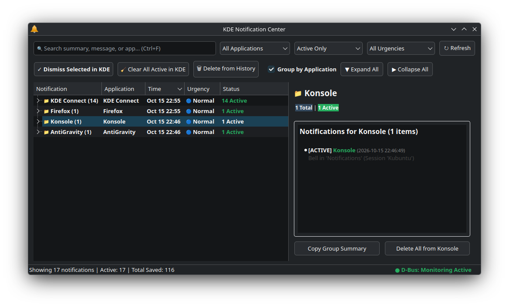

# KDE Notification Center

A standalone, large-format desktop application to manage, filter, and clean up
KDE desktop notifications. KDE Notification Center can comfortably become your
daily notification management application.



## Features

- **Large Resizable Window**: Free yourself from the cramped system tray popup.
- **SQLite History Persistence**: Stores notifications in
  `~/.local/share/knotification_center/notifications.sqlite` so your history
  survives reboots and restarts.
- **Two-Way KDE Sync**:
  - Automatically captures all incoming notifications over D-Bus
    (`org.freedesktop.Notifications`).
  - Automatically updates when notifications are closed or dismissed in KDE.
  - Dismissing or clearing notifications in this app calls `CloseNotification`
    to clean up KDE's tray in real time.
- **Search & Filtering**:
  - Live full-text search across summary, body, and app name (`Ctrl+F`).
  - Filter by specific application (e.g. Slack, Firefox, Thunderbird).
  - Filter by status (`Active Only`, `All History`, `Dismissed`).
  - Filter by urgency (`Critical / Persistent`, `Normal`, `Low`).
- **Batch Cleanup**:
  - Multi-select rows (`Ctrl+Click`, `Shift+Click`).
  - "Dismiss Selected in KDE".
  - "Clear All Active in KDE".
  - "Delete from History" (`Delete` key).
  - "Purge Dismissed > 30 Days".
- **Detail Inspector & Interactions**:
  - Rich text / HTML message browser with clickable links.
  - Interactive action buttons (e.g., Thunderbird "Mark as Read", "Archive", "Delete").
  - Inline quick-reply area (e.g., KDE Connect SMS, Matrix chat).
  - Dismiss notifications after reading them.
  - Copy notification text or group summaries to clipboard.
- **System Tray Integration**:
  - Native KDE `StatusNotifierItem` and `DBusMenu` support.
  - Close or hide window to system tray with window close button or `Ctrl+Q`.
  - Dynamic panel placement (passive/drawer when 0 active notifications,
    active in panel when > 0).
  - Middle-click tray icon to toggle Do Not Disturb mode.
  - Hover tooltip with rich summary of recent unread notifications.

## Launching & Options

- From application launcher / KRunner: Search for **Notification Center**
- From terminal:
  ```bash
  knotification-center
  ```
- Or start silently in background (e.g. at desktop autostart):
  ```bash
  knotification-center --background
  ```
- Debugging:
  ```bash
  knotification-center --debug   # Verbose logging
  ```

## Suggested KDE Tweaks

To seamlessly integrate with KDE Plasma:

1. **System Tray Entries**:
   - Right-click the system tray $\rightarrow$ **Configure System Tray...**
     $\rightarrow$ **Entries**.
   - Set **KDE Notification Center** to **Shown when relevant** so the
     application appears on the panel only when active notifications exist.
   - Set native Plasma **Notifications**  in the System Services section to
     **Always hidden** (or **Shown only in popup**) to avoid duplicate icons.
2. **Keyboard Shortcut (`Meta+N`)**:
   - In **System Settings** $\rightarrow$ **Shortcuts**, assign `Meta+N` to
     launch the notification center (reassigning it from the default Plasma
     notification toggle) to instantly bring up the window. You may need to add
     a new application first.

## Running Tests

An automated regression test suite using an isolated, mock D-Bus session is included:

```bash
PYTHONPATH=. dbus-run-session python3 tests/test_automated.py
```

## AI Disclaimer

This code, feature testing and similar was written with heavy AI assistance.
While I am a Python programmer and guided the coding style, I don't have
experience with D-Bus, PyQt or UI design. The outcomes however were heavily
guided by me, and I do believe those have been done well.
